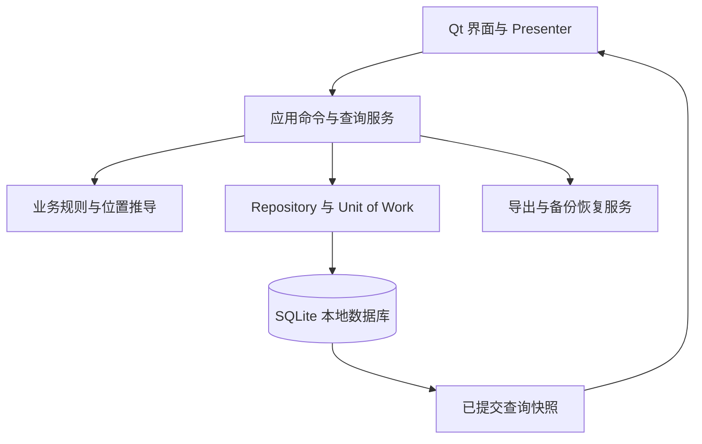

# 货物追踪软件方案（架构与界面对齐稿）

日期：2026-09-29；架构与 UI 联合修订：2026-09-30，版本 R2。本文是 Cargo Track 1.0.0 的产品与架构基线；已实现状态、验证结果及当前限制见文末和[交付说明](./README.md)。

配套：[UI 方案](./货物追踪软件_UI设计方案.md)、[技术审阅与验证](./货物追踪软件_技术审阅.md)、[主界面图](./货物追踪软件_UI主界面示意.png)。本次新增第 9–11 节，补齐分层、数据契约与验收；具体业务约束以本文为准，界面布局以 UI 方案为准。

## 1. 目标与使用方式

建立一个以货物记录为中心的追踪表。用户可以维护船队、为每条货物选择 From 和 To 船舶、更新状态、记录说明与备注，并在按船舶顺序作业时，立即看出当前船需要传送的货物。

**设计重点**：主表沿用截图的操作习惯，但软件需要能回答“这是哪一件货、现在在哪里、经历过哪些转运、下一步去哪里”。截图中多行 `Hard Disk` 说明 Description 不能单独充当货物标识。

**已确认**：先做单用户、本地运行的 Windows 桌面版；数据保存在本机，可备份和导出。建议采用 PySide6 原生桌面界面和 SQLite 本地数据库，交付可直接启动的 Windows 程序。

## 2. 主界面

主界面包含以下区域：

1. **主页面航程栏**：始终显示当前航程及其停靠船舶列表，可直接从 Fleet 选择船舶加入，通过每个站点的菜单单独移除或前后移动，并手动选择当前站。航程为空时仍显示空列表和“添加船舶”入口。这里的“当前船”是作业对象，与你乘坐的转运船不同。
2. **货物追踪表**：沿用截图的字段顺序 `NO | Description | From | To | Status | Comment | Completed Date`，并在 `NO` 后增加一列较窄的 `Cargo ID`；支持新增、编辑、作废记录，以及搜索和按状态、船舶筛选。采用 `All transfers / Current stop / On my vessel` 三个共享表格视图，一行始终表示一段转运；计数区仍独立于表格筛选。
3. **货物详情**：单击选择，Enter、双击或 `Details` 打开详情，显示稳定 Cargo ID、实物识别号、选中转运段及整件货物的当前位置和历史。宽屏可并列打开详情，普通窗口使用独立对话框，避免挤压主表。
4. **船队管理入口**：Fleet 负责新增、重命名、移除船舶；主页面的航程列表从 Fleet 选船，不在航程里临时输入船名。
5. **本船货物清单**：独立显示所有 `On Board` 货物，无论其 From/To 是否为当前停靠船舶；这是核对实际船上货物的入口。

原图是电子表格形式：编号列较窄，Description、Comment 为自由文字；`Done` 目前采用整行红底。新版保留熟悉的表格结构，同时提供更清晰的状态标识和当前船提示。

## 3. 字段与业务规则

| 字段 | 输入与显示规则 |
| --- | --- |
| NO | 新增保存时自动生成的唯一编号，不要求用户填写；作废后旧编号不复用。排序或筛选时编号不改变。 |
| Description | 用户自由输入的货物描述，支持多行文本；新增时必填。 |
| From | 从当前有效船队中选择一艘船，或选择固定地点 `On Shore`；新增时必选。 |
| To | 从当前有效船队中选择一艘船，或选择固定地点 `On Shore`；新增时必选。与 From 相同时提示用户复核。 |
| Status | 仅有 `Waiting`、`On Board`、`Done` 三种状态。新建货物默认为 `Waiting`。 |
| Completed Date | 状态切换为 `Done` 时，按设置中的业务时区记下完成日期；由系统显示，不手工输入。表格默认按截图显示为 `YYYYMMDD`（如 `20260928`）。离开 `Done` 时清空当前完成日期；再次设为 `Done` 时写入新的日期。状态变更历史保留原记录。改变时区设置不会改写已完成记录的原日期。 |
| Comment | 用户自由输入的备注，支持多行和空值；不改变状态。 |

**状态配色**：`Waiting` 用浅琥珀底和深棕字（#FFF2D6 / #7A4B00），`On Board` 用浅蓝底和深蓝字（#DFEDFF / #174B87），`Done` 用浅绿底和深绿字（#E2F3E7 / #17603A）。状态列显示彩色标签，行背景只轻微着色；完成记录不再用整行鲜红，以便长时间浏览。状态始终保留文字，颜色不改变排序或筛选结果。当前船的强调使用紫色左边框，与三种状态色分开。

### 货物身份与位置（建议增强）

- `NO` 继续作为每段转运的主表行号；另为每件货物生成稳定的 `Cargo ID`，在主表显示并支持搜索。即使 Description 同为 `Hard Disk`，也能区分不同实物。
- 如果货物本身有序列号、箱号或贴纸编号，可填入“实物识别号”并搜索；这是把软件记录与真实货物对应起来的依据，留空时不阻碍快速录入。
- **已确认同名货物可能属于两种情况**：一件货物可以有多次 From → To 转运，也可以存在几件描述相同的独立货物。因此主表的一行表示一次转运任务，详情页把同一 `Cargo ID` 的路线串起来；新增时可选“新货物”或“现有货物的下一段转运”。后者默认从上一次目的地接续。
- **已确认你操作的就是转运船**：`On Board` 表示货物已在你的转运船上，无需每次选择另一艘船。From/To 表示本段起点和目的地；船舶顺序中切换的“当前船”是你正在处理的船队船舶。
- 位置规则：`Waiting` 表示**预计**在 From 等待收取，尚未由装船动作确认；`On Board` 是已确认在你的转运船上；`Done` 是已确认交付到 To。详情同时显示“最后确认位置”和“本段预计收取地点”。新货物 Waiting 时最后确认位置为“尚未确认”；接续段 Waiting 时仍保留上一有效 Done 的 To 及确认时间，不能用新计划覆盖已确认事实。转运船名称如有需要，可在设置中填写一次，仅作显示。
- 同一 Cargo ID 同时只允许一段未完成转运；上一段 `Done` 后再新增下一段。否则仅看状态无法确定同一件货的当前位置。若需提前安排后续路线，再增加独立的“计划”功能。
- 正常操作按 `Waiting → On Board → Done` 进行；状态下拉支持直接跳级或撤回，无确认弹窗并自动记录原因与历史。已存在下一段转运时，不得直接撤回上一段完成状态，须先处理后续记录。
- 每次状态变更保留时间与原状态，路线、描述、备注、实物识别号及作废/恢复也留下修改记录。保存后的记录统一采用作废/恢复，取消未保存表单即可放弃草稿，不物理删除持久化台账或复用编号。On Board 段须先通过更正确认实际位置，变为 Waiting 或 Done 后再作废；已有有效后续段时，必须从最后一段倒序处理，不能作废或改写中间段。

例如，两块不同硬盘分别拥有不同的 Cargo ID；同一块硬盘从 `CHA → BVC` 再从 `BVC → On Shore`，则是同一 Cargo ID 下的两段转运。软件从空白台账开始，不凭截图猜测历史货物身份。

## 4. 船队与航程顺序

- 船队列表支持新增、重命名、移除；船名不能重复。选择器只显示有效船舶。
- `On Shore` 是固定地点选项，不属于船队，也不参与航程停靠顺序；它可用于 From 或 To。
- Fleet 的“移除”统一为停用，保留地点 ID 与名称历史，不物理删除目录。货物路线与航程站点保存名称快照，Fleet 重命名不批量改写既有记录；匹配仍依据稳定地点 ID。旧名称与目录现名不同时，详情显示两者。已有未完成转运引用时阻止停用，先更正或完成相关段，避免新段仍依赖停用地点。
- 船队是可选船舶目录；航程是一次实际作业的停靠清单，包含有序的独立站点。同一艘船可在一趟航程中出现多次，例如 `BVC → CHA → BVC`；每次出现都是可单独移除和移动的站点。
- 新航程可从空白建立，**允许零个站点并保存**；也可复制上一航程的顺序后调整。空航程不要求先添加船舶，货物表和本船清单仍可使用。
- 主页面直接显示当前航程的完整顺序和编辑控件：`+ 添加船舶` 打开 Fleet 船舶选择器，选中后新增一个站点；每个站点菜单提供 Move earlier、Move later 和 Remove。菜单操作可由键盘触发，避免依赖拖拽。移除航程站点只影响本航程，不删除 Fleet 船舶，也不改变货物的 From/To。
- **已确认手动切换**：用户手动指定当前航程站点，并用“上一站 / 下一站”切换；切换后保存航程和站点位置，重启仍能继续。不会因时间或货物状态自动跳站。同名船出现多次时，界面显示站点序号，避免跳到错误的一次停靠。
- 菜单调整顺序时，当前站按 stop_id 跟随该站点而非旧位置。移除当前站时将当前站清空，请用户重新选择；移除其他站点时当前站保持不变。航程因此变空时，主页面显示空状态，上一站/下一站不可用。
- Fleet 船舶若仍在当前航程中，移除 Fleet 前提示先移除对应航程站点；历史航程中的同名引用继续保留。历史航程和停靠顺序可回看。

## 5. 当前船货物突出显示

**已确认匹配规则**：当前船舶等于货物的 **From 或 To**，且 Status 不是 `Done`，即视为这艘船相关的待处理货物。`Waiting` 和 `On Board` 均显示，状态仍按各自颜色区分。

- 在追踪表顶部显示紧凑的“当前站作业区”，分别提供可收取、可交付、相关任务计数及入口；最多预览两条可执行任务，完整清单通过 `Current stop` 视图集中列出。每条标注“从当前船收取”（From 匹配）或“向当前船交付”（To 匹配）。
- 按当前可执行的动作排序：`From = 当前船` 且 `Waiting` 为“现在可收取”，按钮可直接标记 `On Board`；`To = 当前船` 且 `On Board` 为“现在可交付”，按钮可直接标记 `Done`。其他未完成的匹配记录也显示，但标为“相关任务”，避免误以为现在就能办理。
- 同一货物在完整表中加紫色左侧强调条；选中行、状态色、文字仍清楚可辨。
- 分别显示待收取、待交付、相关任务的条数；没有匹配货物时显示明确的空状态。
- 手动更改当前船、From 或 Status 后，突出显示立即更新。
- 未设置当前航程或站点时，不显示当前站突出区，完整货物表照常可用。
- “本船货物”入口始终可用：集中列出所有 `On Board` 记录及其 To，即使目的地是未来站点或 `On Shore`。

若 From 和 To 恰好是同一艘船，该货物只显示一次，并提示核查这条路线。

## 6. 数据保存与可靠性

- 使用本地数据库保存货物、船舶、航程与站点、当前站和状态变更历史。
- 数据模型至少区分货物、转运段、状态事件、船舶/地点、航程及停靠站点。船队引用、同一货物仅一段未完成转运等约束由数据库和业务逻辑共同保证。
- 每次保存后立即更新界面；退出并重开后数据与当前船位置保持一致。
- 数据库保存在用户数据目录，与程序安装目录分开，升级程序不会覆盖货物记录。
- 支持导出 CSV/Excel 便于共享，以及手动备份/恢复数据库。备份使用 SQLite Backup API；恢复前校验备份完整性和版本、保留当前数据的安全副本，再替换。CSV/Excel 导出不等同于完整备份。
- 保存后的货物记录采用作废/恢复并保留历史；未保存草稿可以取消。船舶和历史站点保留稳定 ID 与名称快照。所有作废、恢复、更正都由应用服务重新验证约束，不能依靠界面按钮禁用来保证数据正确。
- 首次使用选择业务时区，默认 `Asia/Riyadh`，之后可在设置中修改。内部记录每次操作的 UTC 时间与当时所用时区；Completed Date 是完成瞬间按该时区计算的日期快照，后续改设置不追改历史日期。Windows 安装包须包含时区数据。

## 7. 首版交付范围与验收

首版完成主表、货物新增/编辑/作废、Fleet 管理、主页面可编辑且可为空的航程列表、从 Fleet 添加/单独移除站点、菜单前后移动排序、手动切换当前站、状态颜色与操作、更正历史、自动完成日期、本船货物清单、当前站突出显示、货物稳定编号与多段转运历史、持久保存和导出备份。当前预计少于 100 条未完成货物，从空白数据库开始；首版无需 Excel 导入。多用户实时同步、权限系统和自动推断船舶轮次暂不纳入首版。

验收时逐项核对：

1. 船队新增/移除后，From/To 选择器与已有记录均正确。
2. 三种状态均有固定文字与颜色；`Done` 当天自动写入 Completed Date，撤回及再次完成的日期正确。
3. Description 和 Comment 能输入、修改、保存多行文本。
4. 设置航程顺序并切换当前站后，匹配的未完成货物即时突出；其他货物不误突出。
5. 重启后货物、航程顺序、当前站、完成日期均保持；导出文件内容正确。
6. 两件同名货物可明确区分；一条记录修改状态后能查看原状态与变更时间。
7. 同一货物的第二段转运能接续第一段的 To；设为 `On Board` 后当前位置显示为“本转运船”，而非计划目的地。
8. 一趟航程可以排出 `BVC → CHA → BVC`，切换到第二次 BVC 时能准确显示站点位置；重启后仍停留在该站。
9. 本船货物清单完整列出全部 `On Board` 货物；更改业务时区不会改变已保存的 Completed Date。
10. 航程可以零站点保存；从 Fleet 添加同一船两次、单独移除一次、通过站点菜单调整顺序，都只改变该航程，不改变 Fleet 或货物记录。
11. 菜单移动当前站后仍选中同一个 stop_id；移除当前站后清空当前选择并提示重选；空航程主页面仍显示添加入口和完整货物表。

## 8. 后续扩展边界

1. 如果将来需要提前规划同一件货的多段路线，应增加独立“计划段”，不与当前实际转运状态混用。

## 9. 软件架构与线程职责

### 9.1 架构决定

采用 **PySide6 Qt Widgets + Python + SQLite 的单进程分层桌面应用**。不引入浏览器内核、Web 服务、网络同步、微服务或消息中间件。1.0 主窗口使用 `QMainWindow`、`QTableView`、`QAbstractTableModel`、`QSortFilterProxyModel` 和标准对话框；详情当前使用独立对话框，宽屏 `QSplitter` 是待验证的 UI 演进选项，不属于已实现架构。状态标签由 delegate 绘制，避免为每个单元格创建按钮控件。

| 层/模块 | 职责 | 边界 |
| --- | --- | --- |
| `ui/` | 窗口、表格、delegate、表单、Presenter、键盘与焦点；维护临时输入和视图筛选 | 不执行 SQL，不推导另一套状态规则，不自行写完成日期 |
| `application/commands` | 新增段、编辑、收取、交付、更正、作废恢复、站点管理、时区设置；验证版本并控制事务 | 是持久化写入的唯一入口；失败返回可识别错误码和受影响字段 |
| `application/queries` | 主窗口快照、单件货物详情、历史段与导出范围 | 使用同一套业务谓词和同一读取事务；不从可见行数反推本船数量 |
| `domain/` | 状态机、链路接续、位置可信度、当前站动作分类与停用规则 | 纯业务逻辑，不依赖 Qt；输入为实体/值对象 |
| `infrastructure/sqlite/` | Repository、Unit of Work、建表、外键/索引、schema migration、备份校验 | 不接受任意界面字段作为 SQL；连接严格归属其创建线程 |
| `infrastructure/files/` | CSV/XLSX、备份文件、同目录临时文件与成功后替换 | 失败不覆盖旧文件；导出文本避免被 Excel 解释为公式 |
| `bootstrap/` | 依赖组装、数据目录、单实例本地通道、日志、时区数据 | 界面与存储通过契约连接；首版不建立通用插件框架 |

1.0 的逻辑边界已落在同一 `src/cargo_track/` 包中，文件按职责拆分而非再套多层目录：`ui.py`/`models.py` 负责 Qt 表现，`worker.py` 负责线程消息边界，`service.py` 负责应用命令、查询与事务编排，`domain.py` 保存状态/时间等业务词汇，`repository.py` 提供复用查询，`schema.py` 管理 SQLite 结构和连接，`main.py` 负责组装、数据路径与单实例。服务中保留少量与事务紧密相连的业务校验，避免首版为了形式拆成大量薄层；当规则或团队规模增长，再将服务按命令/查询拆分。Python/PySide6 补丁版本须在成功构建并启动验证后锁定为发布依赖，不把当前开发环境等同于交付环境。

### 9.2 一次操作的完整路径

1. UI 提交 `Command(command_id, operation, payload)`；实体 ID 与 `expected_version` 放在 payload 中。按钮进入保存中，禁止同一动作重复点击；ID 使用数据库实体 ID，不使用排序后的行号或船名。
2. 单一后台写入 worker 在自己创建的连接中启动短事务，再读取当前数据、检查版本及全部业务约束；首次提交的 `command_id` 唯一，重复提交返回原结果，不重复生成状态事件。
3. 同一事务更新转运/站点、时间和日期快照，追加审计事件与成功命令结果，并递增 `data_revision`。任一步失败整笔回滚，不写“操作成功”事件。提交成功先返回成功回执，再刷新读取；提交成功但读取失败显示“已保存，刷新失败”，只重试查询，不重做收取/交付。
4. 提交后生成同一读取事务下的 `WorkspaceSnapshot`，含所有未作废未完成段、三类当前站计数、本船数量、航程站点和 revision。工作线程通过 Qt signal 返回普通数据，不触碰窗口或表格模型。
5. Presenter 在 GUI 线程接收并按主键合并快照，更新各视图、详情和计数，保留排序、滚动位置和选择；所选段已被当前视图排除时清空选择并显示成功结果，不悄悄选中另一件货。

读取结果包含 `dataset_epoch`、`request_id`、视图条件、`data_revision`。每次打开/恢复数据库重置会话 epoch，先排除不同 epoch 的旧返回，再排除过时请求和低于已显示 revision 的结果；避免恢复备份导致 revision 变小时误丢新结果。详情被查看的旧段状态不能覆盖整件货物当前位置。普通编辑不使用乐观“已保存”显示，成功后才更新状态和日期。

### 9.3 后台工作与主窗口响应

- GUI 线程只处理显示和模型通知。1.0 的数据库查询、写入、备份/恢复和导出都由单一常驻 worker 的 `QObject + QThread` 串行处理，SQLite connection 只在创建它的线程中使用。导出期间界面可继续响应，但后续数据库请求排队；若实际数据量导致排队不可接受，再将导出改为“先固定一致快照、再由独立只读连接生成文件”，仍不得跨线程共享 SQLite connection。
- 主工作集少于 100 条，所有未完成段一次加载、本地筛选；已完成与作废历史通过查询服务按需读取，例如每批 200 条，稳定排序包含唯一 NO，并注明“已载入/总计”。`All transfers` 的历史搜索作用于全量数据库，不能仅搜索已加载行。未读完时不能显示为完整总数。
- 不预建 FTS、第二份本地数据库或跨进程缓存。查询与状态写入有忙碌反馈；当前版本不承诺长导出的逐行进度或中途取消。若加入独立长任务，应提供进度与可取消边界，且只允许在不可逆替换/提交前取消。
- 以数据目录内的 `QLockFile` 跨进程锁保证单实例；锁持有者再通过按用户与数据目录派生的 `QLocalServer/QLocalSocket` 通道接收 Activate 请求，使已有窗口回到前台。该本机通知通道不提供业务服务或网络同步。版本检查仍保留以防排队的旧命令或恢复前请求。
- schema migration 在正式加载 UI 前备份并在事务中执行；新于应用支持版本的数据拒绝打开为可写。迁移失败保留原文件及备份，并显示数据路径和恢复方式。

## 10. 数据模型、约束与视图契约

### 10.1 最小实体

| 实体 | 必要字段/约束 |
| --- | --- |
| `cargo` | 内部主键、唯一且不复用的 Cargo ID、默认描述、可选实物识别号、创建 UTC；识别号重复先警示，不擅自合并实物 |
| `locations` | 稳定 ID、类型 `VESSEL/SHORE`、名称、规范化名称键、有效标记；内置唯一 On Shore，不可停用、重命名或成为站点 |
| `transfer_legs` | `NO INTEGER PRIMARY KEY AUTOINCREMENT`、cargo_id、可空 predecessor_leg_id、From/To ID 与名称快照、本段 Description/Comment、三种状态、作废标记、version、完成 UTC/业务日期/时区 |
| `audit_events` | 不可改写事件 ID、对象类型/ID、command_id、事件类型、修改前后值（含名称快照）、UTC、当时时区、原因；既记录状态也记录编辑和作废恢复 |
| `voyages` / `voyage_stops` | 航程 ID/名称、独立 stop_id、vessel_id/名称快照、顺序整数、移除标记；有效站点顺序唯一，船舶 ID 不唯一，允许空航程 |
| `app_state` / `settings` | 唯一 app_state 行保存可空 current_voyage_id/current_stop_id、data_revision；settings 保存业务时区、本船显示名 |
| `command_receipts` / `schema_meta` | 已提交 command_id 及结果摘要；schema 版本。首版不建立通用事件溯源系统，实体表仍是当前状态来源 |

主表 Description 属于本段，创建新货物时也初始化货物默认描述，下一段沿用上一段描述供编辑。编辑旧段描述只改该段并记历史，不批量改写其他段；实物识别号属于整件 cargo，详情中的修改明确提示影响该件货物全部段的身份显示。

### 10.2 存储硬约束与事务

- 每次连接启用 `PRAGMA foreign_keys=ON`；首版采用单写入队列和默认 rollback journal，设置有限 `busy_timeout`。没有实际并行读取瓶颈前不引入 WAL；如后续启用，备份恢复须增加 WAL/SHM 处理验收。
- `transfer_legs` 的部分唯一索引：`UNIQUE(cargo_id) WHERE is_void=0 AND status IN ('Waiting','On Board')`。同时约束 `is_void IN (0,1)`、合法状态、必填 From/To/Description。
- `Done` 必须同时具有完成 UTC、业务日期和完成时区；其他状态这三项必须同时为 NULL。业务日期是不可被时区设置追改的快照，格式在 UI 中为 YYYYMMDD。
- 所有表变更在 Unit of Work 内；状态、时间、审计事件和 revision 同成同败。`expected_version` 不符返回 `STALE_RECORD` 并要求刷新，不覆盖较新数据。
- 前驱段必须同 cargo 且有效 Done，新段只能接在该 cargo 的有效末段之后；跨 cargo、循环、分叉和未完成前驱由业务服务拒绝。外键本身不足以保证这些规则。
- 当前站必须属于当前航程且有效。应用服务先检查，再由存储触发器在设置当前站及修改站点航程归属时兜底；站点归属创建后不可迁移。移除当前站与清空选择同事务完成。
- 站点菜单排序在一次事务中先将有效 position 改成互不重复的临时负数，再写入连续正整数，避免唯一索引在交换过程中冲突。提交失败整笔回滚；选择始终按 stop_id 保留。
- 船名规范化去除首尾空白并忽略大小写后唯一，包括已停用目录。恢复船舶优先复用原 ID，避免同名新船与历史旧船混淆。

### 10.3 状态与路线操作边界

| 操作 | 允许条件与反馈 |
| --- | --- |
| 正常收取 | 有效 Waiting → On Board；当前站 From 匹配可直接办理。详情/本船之外办理时先展示 From 并让使用者确认实物已经装船，支持岸上收取及无航程作业 |
| 正常交付 | 有效 On Board → Done；当前站 To 匹配可直接办理。其他视图先展示 To 并确认已交到该地点，支持 On Shore；不得仅因切站自动完成 |
| Waiting 编辑路线 | 可修改 From/To，保持 cargo_id；接续路线与前驱 To 不一致需说明原因并留历史。From=To 可保存但显示 Check route |
| On Board 编辑 | Comment 可普通编辑；改 To 需原因并记录重定向；From 是已发生事实，改 From 或改状态须进入更正 |
| Done 编辑 | 普通编辑仅描述/备注。改 From/To、状态、位置或完成事实须更正；有有效后续段时阻止，先从末段处理。单纯备注更正不清除完成日期 |
| 作废 | 原因必填；Waiting/Done 且无有效后续段可作废。On Board 须先通过更正确认实物位置，不能直接让其退出本船清单 |
| 恢复 | 原因必填，保持原 NO/Cargo ID；重新校验活跃唯一、前驱和有效末段。作废期间若已建立替代链路，即使替代段已 Done 也阻止恢复旧分支；不能用“继续”绕过硬约束 |
| 更正 | 状态下拉直接提交并自动记录原因；独立字段更正显示影响、原因必填。离开 Done 清空当前完成三字段，历史保留；重新进入 Done 使用本次更正时间和业务日期，不提供任意回填日期 |

普通字段更新不改变 Completed Date。数据中真正的物理位置只能来自有效确认事件和有效段；作废会排除该段的定位依据，详情标注“已作废事件不用于当前位置”，无有效确认时显示未确认。

### 10.4 UI 所用统一查询谓词

设 `active = 未作废且 status != Done`，当前站船舶 ID 为 V；未选当前站时相关集为空。本船清单独立取全部未作废 On Board。

| 分类 | 条件 | UI 行为 |
| --- | --- | --- |
| 可收取 | active 且 Waiting 且 From_id=V | `Pick up`，归入收取计数 |
| 可交付 | active 且 On Board 且 To_id=V | `Deliver`，归入交付计数 |
| 其他相关 | active 且 (From_id=V 或 To_id=V)，排除上面两类 | `Details`，解释不能现在办理的原因 |

三个集合互斥，其并集是当前站相关任务。同船 From=To 只属于一类，不重复计数。所有谓词由查询/业务层共享；当前站计数、本船计数不受主表搜索、历史范围或用户筛选影响。

`WorkspaceSnapshot` 提供会话 dataset_epoch、数据 revision、站点 ID/序号、三个集合的段 ID、本船段 ID 及行 DTO。行 DTO 提供 NO、Cargo ID、本段描述、地点 ID/快照名、状态、备注、日期、允许动作与禁用原因。UI 不从颜色、船名或行序推断动作权限。

### 10.5 备份、恢复与导出

备份使用 SQLite Backup API 写入目标目录临时文件，校验后再替换；不复制正在使用的数据库文件。导出明确选择“全部/当前结果”、历史与作废范围；当前结果先固定查询条件并取得全量一致快照，不只导出已加载页。CSV 用 UTF-8 BOM，XLSX 将用户文本写为字符串，CSV 对以 `= + - @` 开头的文本作公式安全处理并在导出说明中注明。

恢复分两阶段：先只读验证候选文件的完整性、外键、schema、内置地点、当前站归属、状态日期一致性和单件唯一活跃段；预检成功后显示文件时间、记录数、目标数据目录及恢复前备份位置，再由用户确认。确认后进入维护模式、停止并排空读写任务、自动备份现有数据、关闭所有连接，用同目录临时文件替换并重新打开校验。失败恢复原文件；取消或预检失败不触碰原数据。恢复成功清空旧请求、选择和筛选缓存并重新加载，恢复期间禁止录入，不展示旧快照为最新。

## 11. 架构与 UI 联合验收

除第 7 节外必须验证：

1. 同一 Cargo ID 的重复活跃段在业务层和数据库层都被拒绝；中途写事件失败时状态、日期和 revision 全部回滚。
2. 同一个 command_id 重试只产生一次变化；旧 version 命令被拒绝，保存失败保留输入，恢复前查询结果不能覆盖恢复后的界面。
3. 任意表格筛选下，本船和当前站计数仍来自完整未完成集；“其他相关”没有收取/交付按钮，From=To 只计一次。
4. 新段 Waiting 同时展示前段最后确认位置与本段预计 From；选中旧 Done 段不误显示整件货物仍在那里。
5. On Board 直接作废被阻止；替代转运已建立后恢复旧段被阻止；前段已存在有效后段时不能改路线或撤销完成。
6. 船名更改后历史快照仍在，匹配根据 ID 正确；停用被未完成段或当前航程引用的船舶被阻止。
7. 重复站点排序没有唯一键冲突；重排保留 stop_id，移除当前站同步清空；跨航程 current_stop 被拒绝。
8. 图稿在 1366×768、1920×1080 和空航程展示正确；真实程序还需在 100%/125%/150%/200% Windows 缩放、键盘和高对比模式验收。图稿验证不能代替这些运行测试。
9. 以约 100 条未完成段和至少 10,000 条历史段验证窗口响应、全量历史搜索、导出范围与载入计数。首版不承诺未经实测的毫秒指标。
10. 跨业务时区午夜、改时区、重复完成与更正有明确日期结果；备份损坏、版本过新、目录无写权限或恢复打开失败均保留现有数据。

技术依据：[Qt 表格模型线程边界](https://doc.qt.io/qtforpython-6/PySide6/QtCore/QAbstractTableModel.html)、[SQLite 部分唯一索引](https://www.sqlite.org/partialindex.html)、[SQLite Backup API](https://www.sqlite.org/backup.html)。分层和交互边界是本项目的设计决定，官方文档用于核对组件行为。

## 12. 1.0.0 实现状态

1.0.0 已实现单用户 PySide6 桌面程序、SQLite 本地 ledger、事务命令与幂等回执、转运段和审计历史、Fleet/航次/停靠点、三类主表视图、搜索和筛选、CSV/XLSX 导出、SQLite 在线备份与预检恢复。键盘快捷键和宽屏并列详情仍属后续目标。源代码在 `src/cargo_track/`，服务集成测试在 `tests/`，运行界面检查在 `tools/verify_ui_runtime.py`。

数据库和备份默认保存在 Windows 用户本地应用数据目录；也支持通过 `CARGO_TRACK_DATA_DIR` 指定独立数据目录。Windows 发行包使用 PyInstaller onedir 与 PySide6 Essentials 6.8.3，包含应用运行所需的 Qt 库及时区数据。该组合已在本机 Windows 上通过 Setup 解包、独立目录启动、隔离 SQLite 数据目录创建与重复启动激活验证，并同时提供用户级安装程序和便携 ZIP。PySide6 6.11.2 曾在冻结包启动时无法加载 QtCore，因此构建版本固定为已通过运行检查的 6.8.3。首版无 Excel 导入、云同步、多人协作或自动推断实物位置。发行与测试证据见[技术审阅](./货物追踪软件_技术审阅.md)、[README](./README.md)与 `release/release_validation.json`。

## 1.0.1 修订与验证（2026-09-30，替代上文 1.0.0 对应现状）

截图中的黑色区域来自未统一的系统调色板。程序现统一使用 Fusion 浅色调色板，并明确覆盖滚动区、列表、表格空白表头、菜单和禁用控件。已采用原设计 Logo；原图保留，应用抬头使用裁切后的组合标识，程序、安装程序和桌面快捷方式使用其符号图标。搜索与筛选拆分为两行，选中货物信息独立置于操作按钮上方；窗口和对话框根据可用屏幕尺寸收缩。Ctrl+F 搜索、Ctrl+N 新增已实现，其余快捷键仍需逐项确认。

验证结果：19 项服务测试通过，其中 10 项覆盖恢复故障；13 项参考架构检查通过。真实 Windows Qt 窗口在实际有效 100%、125%、150%、175%、200% DPI 下分别验证空数据和有数据状态，检查背景、控件边界、分页区、搜索焦点和无障碍名称；10 个组合均通过。Windows 无障碍树已读取安装版的航站、筛选、表头、货物身份和状态，以及 Fleet 船名、启用状态和引用数量。尚未人工听检 Narrator/NVDA 的实际语音；高对比主题、物理多显示器切换和突然断电仍未验证。

桌面快捷方式已在真实 Windows 桌面创建并成功启动，目标、工作目录及 Logo 图标正确。验证使用独立名称与虚构数据，升级前后数据库校验值一致，重复启动只保留一个应用实例。安装程序现为单文件内嵌载荷，无需同目录配套 ZIP；另提供便携版。

恢复保护覆盖安全备份失败、磁盘写入中断、准备文件校验失败、两阶段替换失败、恢复库打开失败、回滚失败和旧文件清理失败。可回滚时重新打开原台账；替换和回滚同时失败时保留原始回滚文件、安全备份及相关路径，并维持维护模式阻止继续写入。安全备份以逻辑数据一致性校验，保留的原文件另做字节校验；不把模拟文件错误描述为真实断电测试。初始化内置岸上地点时不再推进未使用的自增序号，避免重新打开改变序列。

- 1.0.1 单文件安装程序（历史文件，当前目录未保留）
- 1.0.1 便携版（历史文件，当前目录未保留）
- [完整验证记录](./release/release_validation-1.0.1.json)
- [实际主窗口：150% DPI](./artifacts/validation-1.0.1/main-filled-1.5x.png)
- [实际 Fleet：150% DPI](./artifacts/validation-1.0.1/fleet-empty-1.5x.png)

本次按用户要求未执行 Impeccable 审核。静态方案图已同步 Logo，仍是目标设计，实际布局以运行截图为准。

## 1.0.2 macOS 风格修订（2026-09-30）

根据用户对粗重下拉控件的反馈，实际原生窗口改用更轻的桌面视觉：中性浅灰背景、白色圆角面板、细灰边框、蓝色主操作和分段页签。全部 QComboBox 的箭头区域明确无边框、无独立灰色按钮底，使用随包分发的细线 SVG 箭头；停靠点的分体菜单按钮采用相同箭头和透明菜单区，保留点击选择站点与菜单排序/移除的原有行为。当前站用深色标题和淡蓝选中态，滚动条取消两端按钮，表格关联行降低紫色底的强度。原设计 Logo 保留。NO 列按字符串展示阿拉伯数字，避免平台整数显示产生符号样式。

五档有效 DPI（100/125/150/175/200%）各覆盖空/有数据状态，含筛选弹窗与站点菜单打开检查，全部通过；19 项服务回归和真实 Qt 收货操作通过。窗口仍是 Windows 原生 PySide6 程序，数据、命令与恢复保护边界沿用 1.0.1。实际语音播报、物理多屏切换与高对比主题的未验证范围沿用前版。

- [1.0.2 实际界面](./artifacts/validation-1.0.2/main-filled-1.5x.png)
- [筛选弹窗](./artifacts/validation-1.0.2/filter-menu-filled-1.5x.png)
- 1.0.2 安装程序（历史文件，当前目录未保留）
- [1.0.2 便携版](./release/CargoTrack-1.0.2-Windows-x64.zip)

视觉方向参照 [Apple 弹出按钮设计主题](https://developer.apple.com/design/human-interface-guidelines/pop-up-buttons)，具体尺寸与配色是本应用的实现选择。本次未执行 Impeccable 审核。

1.0.2 最终安装验证：真实桌面快捷方式启动、升级数据保留与重复启动均通过；安装目录包含 Logo 与两款细线箭头资源。完整证据见 [1.0.2 发行验证](./release/release_validation-1.0.2.json)。

## 1.0.3 设置与管理修订（2026-09-30）

设置页的 Business time zone 改为下拉菜单，从本机 Windows 时区注册表读取 UTC 偏移与城市显示名称，并通过 Qt 的 Windows/IANA 映射保存业务时区。原有 IANA 设置保持选中，即使不是 Windows 主映射也不会丢失。修改业务时区只影响之后的业务确认，既有完成日期和审计时区快照不重算。

Database folder 与 Backup folder 提供 Choose 按钮及系统目录选择器，保存前检查可写性。数据库目录变更时在工作线程进入维护模式，SQLite Backup API 生成完整一致副本，独占创建目标文件、校验并打开后才切换服务；旧库保留，已有目标库不覆盖，失败时原库继续使用。备份目录独立保存。两个路径均在本机 QSettings 持久化；正常启动读取保存的数据库目录，CARGO_TRACK_DATA_DIR 保持隔离测试优先。单实例锁使用稳定的用户配置目录，避免改变数据库目录产生第二实例。

Voyages 与 Fleet 增加 Delete 按钮。删除航程会从航程列表移除，删除当前航程同时清空当前站；路线及审计保留。删除船舶会从 Fleet 与正常选船列表移除，被未完成段或当前站点引用时阻止删除并提示先处理关联。历史货物船名及船舶 ID 保留，同名船舶可作为新身份重新添加。删除均写入不可修改的审计事件，不物理删除历史记录。

主窗口选中货物后，底部状态下拉可选择 Waiting / On Board / Done。正常前进复用收货、交付命令和实物位置确认；1.0.3 的回退/跳步需要更正对话框；1.0.4 按本文最新章节改为直接提交并自动记录原因，日期、版本及唯一活跃段仍由业务层校验。修复当前站任务预览误投递到主表的问题，删除当前航程后“全部货物”仍显示完整台账。

按用户最终选择，字体改为 [Inter](https://github.com/rsms/inter)，使用官方 4.1 的 Regular 和 SemiBold 文件，并随安装包附带 SIL Open Font License。采用清晰的系统界面字号、正常正文和半粗标题，延续 macOS 视觉方向。Calibre 不再作为本版交付要求。

验证：26 项服务测试通过；100/125/150/175/200% 有效 DPI 下空/有数据窗口、设置时区、目录显示、菜单、状态下拉、实时迁移和 Fleet/Voyage 删除实际窗口流程通过。迁移覆盖已有目标拒绝、打开失败、备份失败；删除覆盖当前/历史航程、在用船阻止、历史完成转运保留、同名新身份与重新打开数据库。

- [1.0.3 设置页运行图](./artifacts/validation-1.0.3/settings-filled-1.5x.png)
- [1.0.3 主界面运行图](./artifacts/validation-1.0.3/main-filled-1.5x.png)
- 1.0.3 安装程序（历史文件，当前目录未保留）
- [1.0.3 便携版](./release/CargoTrack-1.0.3-Windows-x64.zip)

之前未验证的实际读屏语音、高对比主题和物理多屏切换范围沿用，不将控件接口检查替代人工听检。本次未执行 Impeccable 审核。

## 1.0.4 当前交付：帮助、主题与记录操作（2026-09-30）

本节为当前实现；下述状态下拉规则取代旧版需要确认或填写更正原因的交互。选中货物后，状态下拉直接提交 Waiting / On Board / Done，不显示确认弹窗。正常前进复用收取、交付命令；回退或跳步仍由业务层校验，自动记录变更原因、前后状态与时间。已有有效后续段、重复活跃段及陈旧版本仍会被拒绝；操作失败恢复当前显示。更正字段的独立对话框保留。

底部提供明确的 Delete… 按钮，Waiting 和 Done 的有效末段都可删除。删除填写原因后逻辑作废，保留编号及审计；正常清单隐藏该行。在范围下拉选择 Deleted records，选中行后按钮变为 Restore…，填写原因并重新校验后恢复。On Board 必须先修改状态；已有后续段须先处理后续段。

默认 Inter 正文字号由 9 pt 提高为 11 pt。Settings 的 Font size 可选 Compact 10 / Standard 11 / Large 12 pt。Appearance 提供 Light / Dark，两项保存后立即生效并在重启后保留。主题与字体为本机界面偏好，保存在 QSettings，不修改业务数据库。UI 调色板、样式表、模型背景、状态标签和当前站提示统一读取主题；菜单、下拉列表、输入、禁用控件、滚动条、对话框、帮助链接分别采用对应颜色。原 Logo 在深色模式中置于浅色底板，保证原标识可辨。

主窗口 Help 菜单按功能打开离线中文帮助：快速开始、货物与状态、删除与恢复、船队、航程、搜索与导出、备份与故障恢复、设置与外观、快捷键。F1 打开帮助；Fleet、Voyages、Settings 的 Help 按钮和 F1 定位对应章节。帮助 HTML 随安装包分发，不依赖网络，使用应用字体及当前主题。

验证：26 项服务测试通过；两种主题在 100/125/150/175/200% 有效缩放下检查空/有数据窗口，另检查两种主题的 12 pt、200% 场景，共 24 个状态。实际 Qt 流程覆盖 Done 删除/恢复、状态前进/回退无弹窗、主题及字号即时切换、F1 帮助、设置和船队/航程删除。正文、次要文本、选择态、帮助链接与状态标签的浅/深色对比均不低于 4.5:1。实际桌面快捷方式启动、独立安装程序、升级数据保留和单实例检查的最终结果见发行报告。

- [浅色主界面](./artifacts/validation-1.0.4/light/main-filled-1.5x.png)
- [深色主界面](./artifacts/validation-1.0.4/dark/main-filled-1.5x.png)
- [深色设置页](./artifacts/validation-1.0.4/dark/settings-filled-1.5x.png)
- [帮助窗口](./artifacts/validation-1.0.4/dark/help-filled-1.5x.png)
- [最终安装包 1.0.4](./release/CargoTrack-Setup-1.0.4.exe)
- [便携版 1.0.4](./release/CargoTrack-1.0.4-Windows-x64.zip)
- [发行验证报告](./release/release_validation-1.0.4.json)

实际读屏语音听检、物理多屏切换与 Windows 高对比主题尚未完成；已检查的可访问名称与控件接口不替代这些检查。本次未执行 Impeccable 审核。

## 1.0.5 安装路径与免安装版（2026-09-30）

安装程序先显示 Installation folder，支持手动输入及 Browse 目录选择；Create desktop shortcut 与 Launch Cargo Track after installation 可独立勾选。点击 Install 后才写入文件，Cancel 退出。安装位置是专用父目录，程序位于其 CargoTrack 子目录。已有非空目录只允许识别为 Cargo Track 安装目录；含其他文件的目录、磁盘根目录会被拒绝，避免覆盖无关文件。程序继续支持升级并保留独立数据目录。

免安装版解压整个 ZIP，运行 CargoTrack/CargoTrack.exe 即可；不要单独移动 EXE 或删除 _internal。无需安装 Python。默认业务数据仍保存于用户数据目录，Settings 可以选择数据库及备份路径；免安装是指程序无需安装，并不默认将台账写入程序目录。

验证：安装窗口实际选择与提交、自定义带空格路径安装、取消与选项保留、无关目录和盘符保护通过；独立安装包、实际桌面快捷方式启动、升级保留数据及重复启动通过；免安装 ZIP 已完整解压，实际启动并创建隔离数据库，帮助资源完整。业务与主题功能沿用 1.0.4 实现，未重新声明全套业务测试。

- [安装包 1.0.5](./release/CargoTrack-Setup-1.0.5.exe)
- [免安装版 1.0.5](./release/CargoTrack-1.0.5-Windows-x64.zip)
- [安装路径选择窗口](./artifacts/validation-1.0.5/installer-options.png)
- [发行验证](./release/release_validation-1.0.5.json)

## 1.1.5 审核修复后的当前实现（2026-10-07）

当前业务规则以 PRODUCT.md 的 1.1.5 章节为准。原有两个数据库、稳定 Cargo ID、筛选 NO、Refresh / F5、共享港口和历史计划快照保留。

新增跨模块文件保护；备份及导出不能覆盖已登记的货物或人员数据库，包括另一模块没有打开的情形。人员备份在恢复前核对应用结构和字段类型；恢复保留安全副本，回退失败则阻止继续写入。

恢复、迁移或切换名单后销毁旧编辑器。计划绑定数据库永久身份、恢复代次和完整名单范围，不能从旧缓存发布漏人的计划。来源签名只核对所选 Voyage、相关地点、所选运输段和共享设置；无关历史货物修改不阻断当前计划。

已安排、用户排除、系统无法安排分别记录。系统无法安排的人员列出姓名及原因，正式保存前必须修复或明确从本计划排除；“Remove from plan”可对已未勾选的条目作明确排除。预览和 Excel 都列出排除原因。指定站点失效时保留核对提示，不自动换到另一站；材料也遵守相同规则。

显式修改人员字段时取代该字段旧草稿覆盖，其他草稿字段可继续保留。一个文件的不同工作表或列映射可以追加；同一导入提交由数据库键防重复，完整替换在名单变化后可重做。Excel 按行读取所需列，文件哈希分块计算。

人员写入、备份及恢复由专用串行后台执行器完成，数据库连接不跨线程使用。货物业务设置在同一事务内保存；外观和存储迁移作为后续操作。

当前审核修复说明：output/audit-fixes-20261007/审核修复与更新说明.md；当前发行证据：release/release_validation-1.1.5.json。旧报告和发行证据保留为历史记录，不能用旧版本的测试范围替代本次验证。

## 1.1.6 前端改进（当前实施，2026-10-07）

当前实现和实测结果以 [前端改进与验证说明](./output/frontend-update-20261007/前端改进与验证说明.md)、PRODUCT.md 和 DESIGN.md 为准；本文件中旧版本图示与发行记录保留为历史参考。

货物页合并航程与筛选工具行，保持路线及手动当前站可见。人员页与货物页共用原有品牌、字体和明暗主题；低频历史版本收起，靠船路线与表格使用可调整分隔。1000×700、12 pt 靠船编辑表实测 5 个完整行，1366×768 实测 7 行。

计划操作分为 Save draft、Save plan version 和 Export Excel。带问题可以保存 Draft，正式保存继续核对。先选择导出路径；取消不新增版本。未保存的切换／关闭提供保存、放弃和取消，保存失败保留编辑器。直接姓名／职位单元格修改支持 Ctrl+Z、Ctrl+Shift+Z。

来源变化时保存独立 JSON 恢复副本，再按当前来源重建核对；恢复副本写入失败时保留屏幕内容并禁止发布。历史快照不变，港口仍统一在设置管理，Cargo ID 稳定连续，筛选 NO 从 1 开始，Refresh / F5 保留。

人员台账与草稿使用模型表格、代理筛选、200 ms 输入防抖、按需编辑器和 UUID 选择保持。PlanViewState 集中记录版本、工作草稿、来源代次、编辑、问题、保存和导出状态；业务校验继续位于服务层。显式语义颜色统一 QSS、QPalette 与状态绘制。

当前主界面实测图：[Cargo](./CargoTrack-UI-runtime.png)；[靠船编辑](./output/frontend-update-20261007/scale-1/1366x768-11pt-light-inline.png)。可编辑实现为 src/cargo_track/ui.py、personnel_ui.py、personnel_models.py 与 theme_tokens.py，旧 SVG 未当作新版运行证据。

发行文件为 release/CargoTrack-Setup-1.1.6.exe 和 release/CargoTrack-1.1.6-Windows-x64.zip；完整证据为 release/release_validation-1.1.6.json。115 项测试、真实键盘及窗口、安装／便携／1.1.5 升级验证通过。合成缩放结果不等于物理 DPI、多显示器或讲述器语音认证。

## 1.1.7 全航程展开（当前实施，2026-10-07）

按最新用户要求，货物页完整展开航程内所有停靠，自动换行且不再左右滚动，长船名保持完整。独立停靠身份、手动当前站和站点菜单保留；航程增加高度后，表格使用剩余竖向空间。

当前版本为 1.1.7。120 项测试通过，原生窗口验证 13／24 站各 12 种组合，并验证安装、便携和从 1.1.6 升级后的业务记录保持。说明见 [全航程展开与验证说明](./output/route-overview-20261007/全航程展开与验证说明.md)，发行证据为 release/release_validation-1.1.7.json；此前章节保留为对应版本历史。
